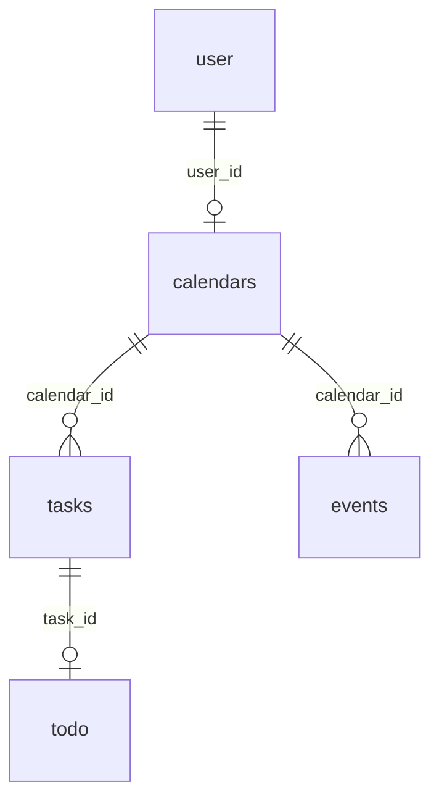
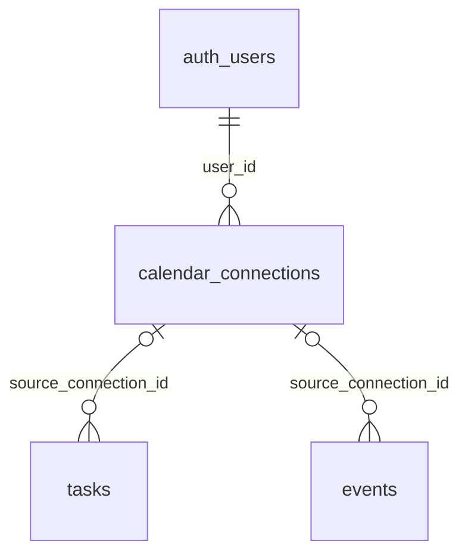
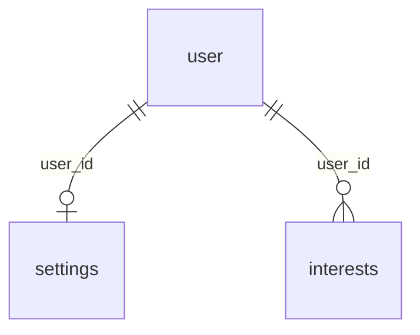
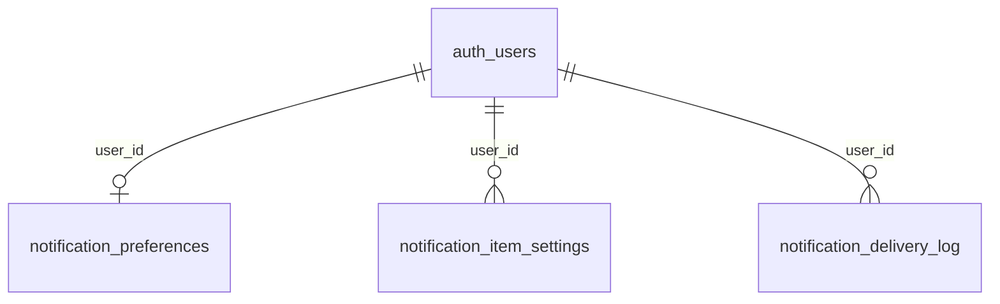
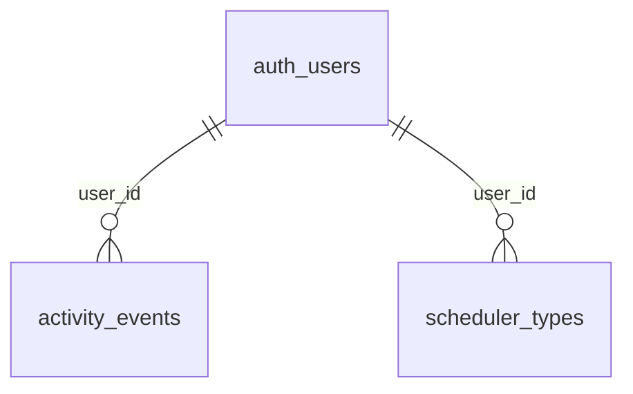

# Upnext

**BYU · IS 401 · Section 01 · Group 4**

Christian Burfeind, Nina Freeman, Addison Laker, Myles Madarieta

Upnext is a student planner that brings classes, assignment deadlines, campus activities, and personal plans into one place. The frontend is a static HTML/CSS/JavaScript app backed by Supabase Auth, PostgreSQL, Storage, and Edge Functions.

- **Repository:** [IS401_CalendarAppProject](https://github.com/ChristianBurfeind/Upnext)
- **Page address:** `https://christianburfeind.github.io/Upnext/`
- **Trello:** [Calendar Organizer — Group 4](https://trello.com/invite/b/6adf6df4f46fb08f117cf9ba/ATTI75b722587a81655ed2712b7e82219e803598B143/calendar-organizer-group-1-4)

> Deployment check: the confirmation URL in `index.html` currently differs from the repository's original Pages path. Confirm the active GitHub Pages address and align `confirmationRedirect`, Supabase Auth Site URL, and allowed redirect URLs before testing signup. This README does not assume the repository has been renamed or a custom domain purchased.

## Latest documentation review

Reviewed changes after the November 8 README update (`5422ec6`) through November 15, 2026 (`892d0f7`), including the November 15 email-notification documentation patch. This review covers the committed source and previously reported calendar-import checks. It does not independently verify the current Supabase deployment, private SQL/dashboard configuration, email delivery, or production Lighthouse scores.

## What's new

- **Upnext branding and Colorblock Studio design:** refreshed login/signup, Summary, navigation, Calendar, To-Do, Discovery, Profile, and Settings. The design uses warm neutral surfaces, cobalt, lilac, and orange, with responsive navigation and Royal, Dark, Forest, and Plum themes.
- **Accessibility improvements:** semantic navigation/main regions, skip link, visible focus styles, labeled controls, keyboard support for legacy click targets, reduced-motion handling, page titles, and contrast adaptation for custom event colors. The release target remains Lighthouse Accessibility **90+**; audit the deployed version before claiming a score.
- **To-Do day/week switch:** view tasks for one day or a full week, navigate dates, open a day from the weekly list, and retain completion controls.
- **Calendar connections in Settings:** save Canvas or Learning Suite links after signup, read provider-specific instructions, and refresh each provider. Either provider can be used alone. Multiple Learning Suite course links can be saved with optional course labels. Profile no longer displays the old connection section.
- **AI Discovery assistant:** enter a question or request personalized event recommendations, read recommendation reasons, open source event pages, and add recommended activities to the calendar.
- **Discovery browsing:** load upcoming campus events from Supabase, filter All/Sports/Career/Social, and save activities to the planner.
- **OKR instrumentation:** signed-in app visits, Calendar visits, and To-Do visits call a Supabase RPC automatically. See the tracking section for what is actually implemented and what still needs documentation.
- **Email notifications:** opt-in event/task reminders, per-item overrides, task snoozing, timezone selection, morning summaries, and a test email button. The repository now includes notification SQL, an Edge Function, and Cron setup instructions.
- **Account flow updates:** confirmation return handling and confirmation-email resend controls with a cooldown. Calendar navigation uses the saved default calendar view.

## Features and progress

**Implemented** means the current repository contains the interface and calling logic. **Previously verified** identifies checks reported during development. Neither label replaces a fresh production release check. **Setup/verification needed** means backend deployment or end-to-end evidence is still required.

| Feature | Current state | Notes |
| --- | --- | --- |
| Email/password signup, confirmation, login, session persistence, logout | Implemented; previously verified | Confirmation resend has a 30-second UI cooldown. Align hosting and Auth redirect URLs. |
| Profile editing, avatars, photo upload/crop | Implemented; previously verified | Supabase Storage stores saved pictures. Public picture URLs are readable by anyone with the URL. |
| Birth date, calculated age, birthday greeting | Implemented; verification needed | In-app birthday greeting; no birthday email. |
| Account deletion | Implemented; previously verified | Two confirmations, server-side deletion, and database/storage cleanup. Recheck coverage when adding tables. |
| Task/event create, edit, delete, categories, priority, repeat controls | Implemented | Verify all actions against the team's deployed schema; custom categories require compatible database constraints. |
| Day/week/month calendars and all-day display | Implemented; imported-data display previously verified | The day grid expands earlier than 6 a.m. when necessary. |
| To-Do day/week views and saved completion | Implemented; completion persistence previously verified | Refreshing imported tasks preserves completion in the deployed importer. |
| Canvas and Learning Suite feed imports | Implemented; previously verified | Settings saves feed links and calls `import-calendar`; backend source is not committed here. |
| Multiple Learning Suite links | Implemented frontend/backend contract | Refresh status supports per-connection counts and failures. Verify all saved courses in the deployed importer. |
| Summary reminders and schedule | Implemented | On-page reminders are separate from email notifications. |
| Discovery browsing, filters, add-to-calendar | Implemented; backend verification needed | Depends on populated `discovered_events`; midnight-crossing activities must currently be added manually. |
| AI event assistant and personalized recommendations | Implemented; backend verification needed | Calls `recommend_events`; server source/model configuration is absent from this repository. |
| Automatic OKR activity tracking | Frontend implemented | Calls `scheduler_log_visit`; SQL, report definitions, and all four KR targets are not committed. |
| Email reminders and daily summary | Implementation and setup files included | Install/deploy/configure and verify delivery; new accounts start with email off. |
| Interest/major alerts for newly posted activities | Not complete | Recommendation UI is not a background matching-alert service. |
| Workday, Apple, and Google integrations | Not complete | No supported connection flow is documented or deployed by this repository. |
| In-calendar suggestions | Control retained for future work | No sample suggestions are required for normal planner use. |

## Using school calendars

1. Find the calendar **feed URL**, not the normal webpage address. Canvas: **Calendar → Calendar Feed**. Learning Suite: open a course, then **Schedule → Get iCalendar Feed**, and copy its subscription URL.
2. Paste a link during signup or open **Settings → School calendars** later. Leave an unused provider blank.
3. For Learning Suite, optionally name the course, save its link, and repeat for other courses. Saving a link does not import records.
4. Select **Refresh Canvas** or **Refresh Learning Suite**. Review saved task/event counts, skipped entries, and any per-link errors.

Previously verified results were **138 tasks + 58 events** for a 196-entry Canvas feed and **264 tasks + 0 events** for a Learning Suite feed. These are sample test results, not fixed counts for every account.

The deployed importer treats all-day assignment entries as tasks and timed entries as events. Learning Suite multi-day assignment availability ranges use the verified due-date convention rather than appearing as long calendar blocks. Repeat imports update matching source records without duplicating them, and preserve completed tasks. Automatic synchronization, removal of entries deleted upstream, and every recurring/timezone edge case should not be assumed supported.

Calendar feed links can grant access to private schedule information. Keep them out of screenshots, logs, commits, and public documentation. Owner-restricted `calendar_connections` policies are required.

## AI Discovery assistant

Discovery is an event-focused question/recommendation interface, rather than a general-purpose persistent chat history. The frontend sends `{ query, interests }` to the `recommend_events` Edge Function and expects recommendations containing an event and a reason. Recommended events can be opened at their source or added to the calendar.

Upcoming browsing uses `discovered_events`, ordered by `start_time`, with a limit of 50 results. Add-to-calendar converts times to `America/Denver`, uses a one-hour fallback if no end is provided, and checks the loaded calendar for matching title/date/time to reduce accidental duplicate additions. This is not a database-wide uniqueness guarantee.

**AI Discovery Preferences** are stored in this browser's local storage under the signed-in user's ID. They are distinct from profile interests stored in Supabase and do not automatically synchronize across devices.

The repository does not include the `recommend_events` implementation, the event ingestion process, or its SQL/RLS policies. Record the deployed model/provider, data source, secrets, and ingestion schedule when those backend artifacts are added. Keep any AI credentials server-side.

## Supabase and OKR tracking

The November 13 `OKR commit 1` added `logActivityVisit` and `trackActivityPage`. The frontend calls:

```javascript
sb.rpc("scheduler_log_visit", { visit_type: type });
```

| Visit type | Trigger in the current frontend |
| --- | --- |
| `app_opened` | A signed-in user enters the active app context, or the tab becomes visible again. |
| `calendar_viewed` | Navigation enters Calendar; day/week/month count as the same page group. |
| `tasks_viewed` | Navigation enters To-Do. |

Tracking is limited to live signed-in users, not demo mode. Page state in session storage suppresses repeated page-view calls during rerenders and reloads of the same page. Switching between Calendar views is not a new Calendar-page entry. `app_opened` includes tab returns; it must not be interpreted as a unique person, unique daily user, or login count without server-side aggregation.

The supplied schema export now confirms an activity_events object with task_created, event_created, task_completed, tasks_viewed, calendar_viewed, and app_opened event types, plus daily/weekly OKR reporting objects (see the ERD below). The export does not establish which database triggers populate item actions or how reports aggregate them. The Supabase RPC decides how records are stored and deduplicated. Failures are logged as warnings without stopping the planner. The RPC definition, underlying activity tables, dashboards/views, four agreed Key Result targets, and calculation formulas are **not present in the repository**. Consequently, this README confirms instrumentation, not that every OKR target has been achieved. Export the deployed SQL/report definitions and add measured results before marking all four KRs complete.

## Email notifications

Follow [NOTIFICATIONS-SETUP.md](NOTIFICATIONS-SETUP.md). This feature is separate from Supabase Auth confirmation emails and from on-page Summary reminders.

- Email starts disabled; users opt in under **Settings → Email notifications**.
- Event reminders support a default lead time and per-event overrides.
- Task reminders support a chosen date/time and snooze-to-tomorrow without creating duplicate tasks.
- Daily summaries include today's events and unfinished tasks due today or earlier.
- Timezone defaults to `America/Denver`, with a device-timezone option.
- The test action sends only to the signed-in user's Auth email.

`notifications-setup.sql` creates `notification_preferences`, `notification_item_settings`, and `notification_delivery_log`, including owner policies and a server-only delivery-claim function. The worker uses Gmail SMTP and delivery tracking to guard against duplicate sends. `notifications-cron.sql` schedules checks every minute using Supabase Vault secrets. Deploying source files alone does not install the database, secrets, or Cron job.

## Technology and repository map

| File/service | Purpose |
| --- | --- |
| `index.html` | Frontend routes, styles, planner UI, Auth, data access, Discovery, and tracking calls. |
| `byu-campus.jpg`, `byu-tower.jpg` | Local image assets. |
| `scheduler-setup.sql` | Core scheduler/account/profile security, birthday fields, storage policies, and deletion cleanup on its expected schema. |
| [START-HERE.md](START-HERE.md) | Existing-project setup guidance; some old branding/placeholder descriptions remain historical. |
| `index.ts`, `config.toml` | Account-deletion Edge Function source and configuration; deploy as `delete-account`. |
| [DELETE-ACCOUNT-SETUP.md](DELETE-ACCOUNT-SETUP.md) | Account-deletion deployment instructions. |
| `notifications-setup.sql`, `notifications-cron.sql` | Notification schema/security and scheduled invocation. |
| `supabase/functions/notification-scheduler/` | Notification worker and its Deno dependency configuration. |
| `supabase/config.toml` | Supabase function gateway configuration. |
| `backup/` | Historical frontend backup, not the production entry point. |
| Supabase | Auth, PostgreSQL, Storage, RPCs, and Edge Functions. |
| GitHub Pages | Static frontend hosting; no Node server/build is required. |

### Backend dependencies not fully captured in Git

The current frontend expects the team's existing database, including `calendars`, `calendar_connections`, `scheduler_types`, `discovered_events`, and its compatible user/settings/interests/tasks/events/completion tables. Task/event ownership columns and IDs must match the frontend schema mapping; existing team tables may differ from the fallback tables in setup SQL.

The deployed calendar import also relies on source-connection/source-event identity, unique constraints, all-day support, and task-import database behavior. Do not assume `scheduler-setup.sql` reproduces these additions in an empty project.

| Dependency | Included here? |
| --- | --- |
| `delete-account` | Yes, root `index.ts`; SQL and deployment guide included. |
| `notification-scheduler` | Yes, function directory, SQL, Cron, and guide included. |
| `import-calendar` and its import SQL/RPCs | No; retain/export the existing deployed versions. |
| `recommend_events` and Discovery ingestion/schema | No; retain/export the existing deployed versions. |
| `scheduler_log_visit` and OKR reporting SQL | No; retain/export the existing deployed versions. |

A clone is therefore **not a complete Supabase disaster-recovery package**. Keep using the team's project until the missing migrations/functions are versioned. Do not replace the working schema with fallback tables simply to match a setup script.

## Run locally and deploy

1. Clone/download this repository and open it in VS Code.
2. In `index.html`, configure `SUPABASE_URL` with the base `.supabase.co` URL and `SUPABASE_ANON_KEY` with the public publishable/anon key. Keep placeholder comparisons unchanged. Never put service-role keys or SMTP/AI secrets in HTML.
3. Use the existing team database. Read [START-HERE.md](START-HERE.md) before running setup SQL; review policies/schema compatibility and back up data first. Do not run legacy `setup.sql` afterward.
4. Install VS Code **Live Server**, then right-click `index.html` → **Open with Live Server**. No npm install is needed for the frontend.
5. Configure Supabase Auth Site URL/allowed redirects and the frontend `confirmationRedirect` for the actual hosted address. Local testing should use an allowed local address if confirmation should return there.
6. Create a test account, open the newest confirmation email, log in, and check persistence after refresh.
7. Publish frontend changes through the repository's GitHub Pages configuration. Edge Functions, SQL migrations, server secrets, and Cron are deployed separately to Supabase.

When changing the repository path or adding a custom domain, update Auth redirects as well as frontend links. Existing account data remains in the same Supabase project.

## Verification and Definition of Done

Before marking a release complete, record checks against the exact deployed commit:

- Signup, newest confirmation link, resend cooldown, login, saved session, logout, and default Calendar view.
- Profile edits, photo crop/upload/cancel, birthday behavior, and persistence after reload.
- Task/event create/edit/delete, completion persistence, categories, repeat rules, and all Calendar/To-Do views.
- Canvas alone, Learning Suite alone, multiple course feeds, repeat refresh without duplicate records, and preservation of completed tasks.
- Discovery filters, recommendations, source links, add-to-calendar, and visible handling of backend failures.
- OKR RPC calls, database records/aggregations, RLS isolation, and the team's actual four KR calculations.
- Email opt-in/out, timezone boundaries, per-item overrides, test delivery, scheduled reminders, daily summary, and delivery deduplication.
- Desktop/mobile layout, keyboard navigation, contrast, reduced motion, and Lighthouse Accessibility **90+** on relevant deployed pages. Performance/Best Practices/SEO should also be measured; do not treat design intent as an audit result.
- Account deletion using a disposable user: both Cancel choices, final deletion, associated row/file cleanup, and isolation from another account.
- Changes merged into `main`, deployed at the public address, and README status updated with evidence.

No live user data, email sending, account deletion, or Supabase schema changes were performed for this documentation review. Remaining documentation priorities are exporting the deployed calendar/AI/OKR backend, resolving the hosting/confirmation URL discrepancy, and recording current release-test and OKR results. Trello remains the source for sprint assignments, estimates, and agreed OKR targets.


## Database ERD and schema reference

Based on the Supabase public-schema export supplied November 15, 2026. This covers every object and column in that export, plus the referenced `auth.users(id)` boundary. Supabase-managed Auth/Storage internals, policies, triggers, functions, indexes outside exported constraints, and view definitions were not exported. This is a structural reference, not a database restore script.

The diagrams show only exported foreign keys. `||` means exactly one, `o|` zero or one, and `o{` zero or many. All child collections can be empty. The schema permits one calendar per public profile, and zero or one completion row per task.

### Planner and imports





### Profiles and preferences



### Notifications and tracking





### Relationships that are not foreign keys

- `public.user.user_id` has a primary key but the export shows **no foreign key to `auth.users`**. Matching UUIDs/app behavior are not a database-enforced relationship.
- `tasks."User_ID"` and `events."User_ID"` are nullable UUID columns with no exported foreign keys. Calendar ownership is enforced separately through `calendar_id` and its profile relationship.
- `notification_item_settings.item_id`, `notification_delivery_log.source_id`, and `activity_events.item_id` are text identifiers, not foreign keys to tasks/events. The application/server decides their meaning.
- `scheduler_types` has no foreign key from task/event `type`; those labels are not an enforced category relationship.
- `discovered_events` has no exported foreign keys. Adding a discovery event creates a planner entry without a recorded FK back to its discovery row.
- `okr_daily_activity` and `okr_weekly_activity` expose reporting columns but no constraints in this export. The export query did not include object kinds or view definitions, so whether they are views or tables and how they aggregate activity cannot be established from this file alone.
- Import connections are unique by `(user_id, provider, feed_url)`. Tasks/events each have a composite unique constraint on `(source_connection_id, source_event_key)`; nullable source columns allow manual entries.
- Deleting a connection sets source references to NULL rather than deleting its imported planner records. Other exported foreign keys use `ON DELETE CASCADE`.

### Complete exported column dictionary

`PK` identifies membership in a primary key; `FK` identifies an exported foreign key. Composite keys/uniqueness are listed in full below each object. Identity columns use PostgreSQL-generated identifiers. Array types retain their PostgreSQL internal type names. The legacy `user.password` column is listed for schema accuracy; active credentials belong in Supabase Auth, not this column.

#### `public.activity_events`

| Column | PostgreSQL type | Nullable | Key | Default / generation |
| --- | --- | --- | --- | --- |
| `id` | `int8` | No | PK | Identity |
| `user_id` | `uuid` | No | FK | — |
| `event_type` | `text` | No | — | — |
| `occurred_at` | `timestamptz` | No | — | now() |
| `item_id` | `text` | Yes | — | — |

Exported constraints:

- `activity_events_check`: `CHECK ((item_id IS NOT NULL) = (event_type = ANY (ARRAY['task_created'::text, 'event_created'::text, 'task_completed'::text])))`
- `activity_events_event_type_check`: `CHECK (event_type = ANY (ARRAY['task_created'::text, 'event_created'::text, 'task_completed'::text, 'tasks_viewed'::text, 'calendar_viewed'::text, 'app_opened'::text]))`
- `activity_events_pkey`: `PRIMARY KEY (id)`
- `activity_events_user_id_fkey`: `FOREIGN KEY (user_id) REFERENCES auth.users(id) ON DELETE CASCADE`

#### `public.calendar_connections`

| Column | PostgreSQL type | Nullable | Key | Default / generation |
| --- | --- | --- | --- | --- |
| `id` | `uuid` | No | PK | gen_random_uuid() |
| `user_id` | `uuid` | No | FK | auth.uid() |
| `provider` | `text` | No | — | — |
| `feed_url` | `text` | No | — | — |
| `label` | `text` | Yes | — | — |
| `created_at` | `timestamptz` | No | — | now() |

Exported constraints:

- `calendar_connections_feed_url_check`: `CHECK (length(TRIM(BOTH FROM feed_url)) > 0)`
- `calendar_connections_pkey`: `PRIMARY KEY (id)`
- `calendar_connections_provider_check`: `CHECK (provider = ANY (ARRAY['canvas'::text, 'learning_suite'::text]))`
- `calendar_connections_user_id_fkey`: `FOREIGN KEY (user_id) REFERENCES auth.users(id) ON DELETE CASCADE`
- `calendar_connections_user_id_provider_feed_url_key`: `UNIQUE (user_id, provider, feed_url)`

#### `public.calendars`

| Column | PostgreSQL type | Nullable | Key | Default / generation |
| --- | --- | --- | --- | --- |
| `calendar_id` | `int8` | No | PK | Identity |
| `user_id` | `uuid` | No | FK | — |

Exported constraints:

- `calendars_pkey`: `PRIMARY KEY (calendar_id)`
- `calendars_user_id_fkey`: `FOREIGN KEY (user_id) REFERENCES "user"(user_id) ON DELETE CASCADE`
- `calendars_user_id_key`: `UNIQUE (user_id)`

#### `public.discovered_events`

| Column | PostgreSQL type | Nullable | Key | Default / generation |
| --- | --- | --- | --- | --- |
| `id` | `int8` | No | PK | Identity |
| `source` | `text` | No | — | — |
| `source_event_id` | `text` | No | — | — |
| `title` | `text` | No | — | — |
| `description` | `text` | Yes | — | — |
| `category` | `text` | Yes | — | — |
| `location` | `text` | Yes | — | — |
| `start_time` | `timestamptz` | Yes | — | — |
| `end_time` | `timestamptz` | Yes | — | — |
| `source_url` | `text` | Yes | — | — |
| `last_synced_at` | `timestamptz` | Yes | — | now() |

Exported constraints:

- `discovered_events_pkey`: `PRIMARY KEY (id)`
- `discovered_events_source_source_event_id_key`: `UNIQUE (source, source_event_id)`

#### `public.events`

| Column | PostgreSQL type | Nullable | Key | Default / generation |
| --- | --- | --- | --- | --- |
| `event_id` | `int8` | No | PK | Identity |
| `calendar_id` | `int8` | No | FK | — |
| `event_title` | `text` | No | — | — |
| `date` | `date` | No | — | — |
| `start_time` | `time` | Yes | — | — |
| `end_time` | `time` | Yes | — | — |
| `is_repeatable` | `bool` | No | — | false |
| `location` | `text` | Yes | — | — |
| `type` | `text` | No | — | 'Personal'::text |
| `priority` | `text` | No | — | 'Standard'::text |
| `description` | `text` | Yes | — | — |
| `User_ID` | `uuid` | Yes | — | — |
| `source_connection_id` | `uuid` | Yes | FK | — |
| `source_event_key` | `text` | Yes | — | — |
| `is_all_day` | `bool` | No | — | false |
| `series_id` | `uuid` | Yes | — | — |
| `repeat_frequency` | `text` | Yes | — | — |
| `repeat_days` | `_int4` | No | — | '{}'::integer[] |
| `repeat_until` | `date` | Yes | — | — |
| `repeat_exceptions` | `_date` | No | — | '{}'::date[] |
| `color` | `text` | Yes | — | '#2563eb'::text |
| `event_color` | `text` | Yes | — | — |

Exported constraints:

- `events_calendar_id_fkey`: `FOREIGN KEY (calendar_id) REFERENCES calendars(calendar_id) ON DELETE CASCADE`
- `events_event_color_check`: `CHECK (event_color ~ '^#[0-9A-Fa-f]{6}$'::text)`
- `events_import_unique`: `UNIQUE (source_connection_id, source_event_key)`
- `events_pkey`: `PRIMARY KEY (event_id)`
- `events_source_connection_id_fkey`: `FOREIGN KEY (source_connection_id) REFERENCES calendar_connections(id) ON DELETE SET NULL`
- `scheduler_event_day_times`: `CHECK (is_all_day AND start_time IS NULL AND end_time IS NULL OR NOT is_all_day AND start_time IS NOT NULL AND end_time IS NOT NULL) NOT VALID`
- `scheduler_type_label`: `CHECK (char_length(btrim(type)) >= 1 AND char_length(btrim(type)) <= 80) NOT VALID`

#### `public.interests`

| Column | PostgreSQL type | Nullable | Key | Default / generation |
| --- | --- | --- | --- | --- |
| `user_id` | `uuid` | No | PK, FK | — |
| `interests` | `text` | No | PK | — |

Exported constraints:

- `interests_pkey`: `PRIMARY KEY (user_id, interests)`
- `interests_user_id_fkey`: `FOREIGN KEY (user_id) REFERENCES "user"(user_id) ON DELETE CASCADE`

#### `public.notification_delivery_log`

| Column | PostgreSQL type | Nullable | Key | Default / generation |
| --- | --- | --- | --- | --- |
| `user_id` | `uuid` | No | PK, FK | — |
| `dedupe_key` | `text` | No | PK | — |
| `notification_type` | `text` | No | — | — |
| `source_id` | `text` | Yes | — | — |
| `occurrence_date` | `date` | Yes | — | — |
| `scheduled_for` | `timestamptz` | Yes | — | — |
| `status` | `text` | No | — | — |
| `attempts` | `int4` | No | — | 1 |
| `last_attempt_at` | `timestamptz` | No | — | now() |
| `sent_at` | `timestamptz` | Yes | — | — |
| `last_error` | `text` | Yes | — | — |

Exported constraints:

- `notification_delivery_log_attempts_check`: `CHECK (attempts > 0)`
- `notification_delivery_log_notification_type_check`: `CHECK (notification_type = ANY (ARRAY['event'::text, 'task'::text, 'daily_summary'::text, 'test'::text]))`
- `notification_delivery_log_pkey`: `PRIMARY KEY (user_id, dedupe_key)`
- `notification_delivery_log_status_check`: `CHECK (status = ANY (ARRAY['sending'::text, 'sent'::text, 'failed'::text]))`
- `notification_delivery_log_user_id_fkey`: `FOREIGN KEY (user_id) REFERENCES auth.users(id) ON DELETE CASCADE`

#### `public.notification_item_settings`

| Column | PostgreSQL type | Nullable | Key | Default / generation |
| --- | --- | --- | --- | --- |
| `user_id` | `uuid` | No | PK, FK | — |
| `item_type` | `text` | No | PK | — |
| `item_id` | `text` | No | PK | — |
| `reminder_enabled` | `bool` | No | — | true |
| `event_lead_minutes` | `int4` | Yes | — | — |
| `task_reminder_date` | `date` | Yes | — | — |
| `task_reminder_time` | `time` | Yes | — | — |
| `updated_at` | `timestamptz` | No | — | now() |

Exported constraints:

- `notification_item_settings_check`: `CHECK (item_type <> 'event'::text OR task_reminder_date IS NULL AND task_reminder_time IS NULL)`
- `notification_item_settings_check1`: `CHECK (item_type <> 'task'::text OR event_lead_minutes IS NULL)`
- `notification_item_settings_event_lead_minutes_check`: `CHECK (event_lead_minutes >= 0 AND event_lead_minutes <= 43200)`
- `notification_item_settings_item_type_check`: `CHECK (item_type = ANY (ARRAY['event'::text, 'task'::text]))`
- `notification_item_settings_pkey`: `PRIMARY KEY (user_id, item_type, item_id)`
- `notification_item_settings_user_id_fkey`: `FOREIGN KEY (user_id) REFERENCES auth.users(id) ON DELETE CASCADE`

#### `public.notification_preferences`

| Column | PostgreSQL type | Nullable | Key | Default / generation |
| --- | --- | --- | --- | --- |
| `user_id` | `uuid` | No | PK, FK | — |
| `email_enabled` | `bool` | No | — | false |
| `event_reminders_enabled` | `bool` | No | — | true |
| `event_lead_minutes` | `int4` | No | — | 15 |
| `task_reminders_enabled` | `bool` | No | — | true |
| `task_reminder_time` | `time` | No | — | '18:00:00'::time without time zone |
| `daily_summary_enabled` | `bool` | No | — | false |
| `daily_summary_time` | `time` | No | — | '08:00:00'::time without time zone |
| `time_zone` | `text` | No | — | 'America/Denver'::text |
| `created_at` | `timestamptz` | No | — | now() |
| `updated_at` | `timestamptz` | No | — | now() |

Exported constraints:

- `notification_preferences_event_lead_minutes_check`: `CHECK (event_lead_minutes >= 0 AND event_lead_minutes <= 43200)`
- `notification_preferences_pkey`: `PRIMARY KEY (user_id)`
- `notification_preferences_user_id_fkey`: `FOREIGN KEY (user_id) REFERENCES auth.users(id) ON DELETE CASCADE`

#### `public.okr_daily_activity`

| Column | PostgreSQL type | Nullable | Key | Default / generation |
| --- | --- | --- | --- | --- |
| `user_id` | `uuid` | Yes | — | — |
| `activity_day` | `date` | Yes | — | — |
| `tasks_completed` | `int8` | Yes | — | — |
| `todo_visits` | `int8` | Yes | — | — |
| `calendar_visits` | `int8` | Yes | — | — |

Exported constraints:

None. Object kind and reporting definition were not included in the export.

#### `public.okr_weekly_activity`

| Column | PostgreSQL type | Nullable | Key | Default / generation |
| --- | --- | --- | --- | --- |
| `user_id` | `uuid` | Yes | — | — |
| `week_start` | `date` | Yes | — | — |
| `tasks_created` | `int8` | Yes | — | — |
| `events_created` | `int8` | Yes | — | — |
| `days_visited` | `int8` | Yes | — | — |

Exported constraints:

None. Object kind and reporting definition were not included in the export.

#### `public.scheduler_types`

| Column | PostgreSQL type | Nullable | Key | Default / generation |
| --- | --- | --- | --- | --- |
| `user_id` | `uuid` | No | PK, FK | — |
| `name` | `text` | No | — | — |
| `name_key` | `text` | No | PK | — |

Exported constraints:

- `scheduler_types_name_check`: `CHECK (char_length(name) >= 1 AND char_length(name) <= 80 AND btrim(name) <> ''::text)`
- `scheduler_types_pkey`: `PRIMARY KEY (user_id, name_key)`
- `scheduler_types_user_id_fkey`: `FOREIGN KEY (user_id) REFERENCES auth.users(id) ON DELETE CASCADE`

#### `public.settings`

| Column | PostgreSQL type | Nullable | Key | Default / generation |
| --- | --- | --- | --- | --- |
| `user_id` | `uuid` | No | PK, FK | — |
| `default_view` | `text` | No | — | 'Day'::text |
| `week_start_day` | `text` | No | — | 'Sunday'::text |
| `theme_choice` | `text` | No | — | 'Light'::text |
| `ai_suggestion` | `bool` | No | — | true |
| `notifications_enabled` | `bool` | No | — | true |

Exported constraints:

- `settings_pkey`: `PRIMARY KEY (user_id)`
- `settings_user_id_fkey`: `FOREIGN KEY (user_id) REFERENCES "user"(user_id) ON DELETE CASCADE`

#### `public.tasks`

| Column | PostgreSQL type | Nullable | Key | Default / generation |
| --- | --- | --- | --- | --- |
| `task_id` | `int8` | No | PK | Identity |
| `calendar_id` | `int8` | No | FK | — |
| `task_title` | `text` | No | — | — |
| `date` | `date` | No | — | — |
| `is_repeatable` | `bool` | No | — | false |
| `type` | `text` | No | — | 'Personal'::text |
| `priority` | `text` | No | — | 'Standard'::text |
| `description` | `text` | Yes | — | — |
| `User_ID` | `uuid` | Yes | — | — |
| `source_connection_id` | `uuid` | Yes | FK | — |
| `source_event_key` | `text` | Yes | — | — |

Exported constraints:

- `scheduler_type_label`: `CHECK (char_length(btrim(type)) >= 1 AND char_length(btrim(type)) <= 80) NOT VALID`
- `tasks_calendar_id_fkey`: `FOREIGN KEY (calendar_id) REFERENCES calendars(calendar_id) ON DELETE CASCADE`
- `tasks_import_unique`: `UNIQUE (source_connection_id, source_event_key)`
- `tasks_pkey`: `PRIMARY KEY (task_id)`
- `tasks_source_connection_id_fkey`: `FOREIGN KEY (source_connection_id) REFERENCES calendar_connections(id) ON DELETE SET NULL`

#### `public.todo`

| Column | PostgreSQL type | Nullable | Key | Default / generation |
| --- | --- | --- | --- | --- |
| `task_id` | `int8` | No | PK, FK | — |
| `is_complete` | `bool` | No | — | false |

Exported constraints:

- `todo_pkey`: `PRIMARY KEY (task_id)`
- `todo_task_id_fkey`: `FOREIGN KEY (task_id) REFERENCES tasks(task_id) ON DELETE CASCADE`

#### `public.user`

| Column | PostgreSQL type | Nullable | Key | Default / generation |
| --- | --- | --- | --- | --- |
| `user_id` | `uuid` | No | PK | — |
| `name` | `text` | No | — | — |
| `school` | `text` | Yes | — | — |
| `work` | `text` | Yes | — | — |
| `age` | `int4` | Yes | — | — |
| `gender` | `text` | Yes | — | — |
| `major` | `text` | Yes | — | — |
| `password` | `text` | Yes | — | — |
| `photo_path` | `text` | Yes | — | — |
| `avatar_id` | `text` | Yes | — | — |
| `birth_date` | `date` | Yes | — | — |

Exported constraints:

- `profiles_pkey`: `PRIMARY KEY (user_id)`
- `scheduler_birth_date_not_future`: `CHECK (birth_date IS NULL OR birth_date <= CURRENT_DATE) NOT VALID`
